<picture>
  <source media="(prefers-color-scheme: dark)" srcset="assets/banner_dark.svg">
  
</picture>

I'm a bioinformatics scientist at [SelfDecode](https://selfdecode.com) in Los Angeles. I work on human genetics, mostly on the algorithms behind it.

### What I work on

**Population genetics algorithms.** Haplotype models for phasing and imputation, reference panels, and how well they hold up across populations and data types (arrays, whole genomes, low-coverage sequencing).

**Variants and mutations.** Finding them, checking them and working out what they mean, from single SNPs to rare and clinically relevant variants.

**Reading genomic data.** Fast readers and writers for VCF, BCF, BAM/CRAM and custom panel formats, so that raw files become something an analysis can actually use.

### Right now

[**Selphi 2**](https://github.com/omicsedge/selphi2) is a phasing and imputation engine written in Rust. It takes arrays, WGS and low-coverage BAM/CRAM, imputes against a reference panel, and builds for x86 and arm64.

### Tools I use every day

### Find me

[helixirgenomics.com](https://helixirgenomics.com) · [X / Twitter @adrian_wesc](https://x.com/adrian_wesc)
